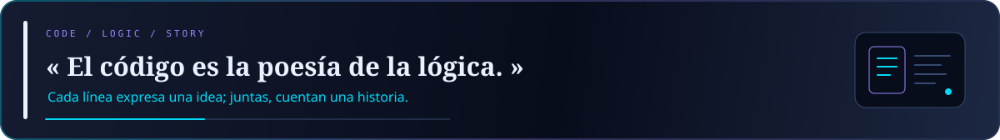
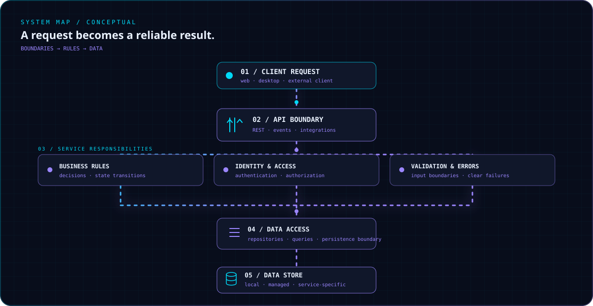
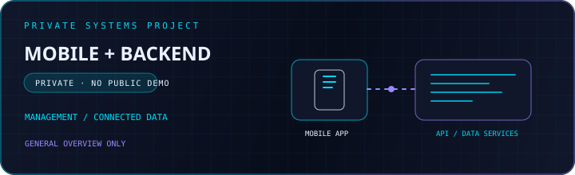
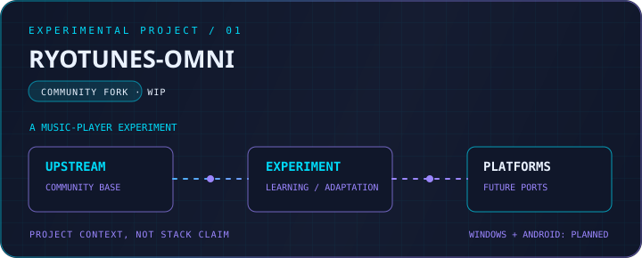
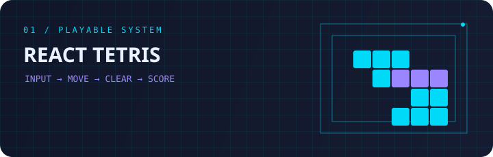

 

  

 

 

## 01 / IDENTITY

Soy **Excentry**, desarrollador Full Stack interesado en construir aplicaciones de principio a fin: lógica de servidor, APIs, datos e interfaces que conecten la experiencia completa.

## 02 / MY TECH STACK

<table align="center">
<tr>
<td width="50%" align="center" valign="top">

### BACKEND

&nbsp;&nbsp;

</td>
<td width="50%" align="center" valign="top">

### DATABASES

&nbsp;　`SQL`

</td>
</tr>
<tr>
<td width="50%" align="center" valign="top">

### FRONTEND

&nbsp;

</td>
<td width="50%" align="center" valign="top">

### TOOLS & ENVIRONMENT

&nbsp;&nbsp;

</td>
</tr>
</table>

## 03 / BACKEND ARCHITECTURE

`CLIENT`　→　`API`　→　`SERVICES`　→　`BUSINESS LOGIC`　→　`DATA ACCESS`　→　`DATABASE`

## 04 / FEATURED PROJECTS

<table align="center">
<tr>
<td width="39%" align="center" valign="top">

**CONTROL PLATFORM** 
`PRIVATE`　`NO PUBLIC DEMO`

</td>
<td width="61%" align="center" valign="top">

Aplicación de gestión y monitoreo con cliente móvil y servicios backend.

&nbsp;&nbsp;&nbsp;&nbsp;

</td>
</tr>
</table>

<table align="center">
<tr>
<td width="50%" align="center" valign="top">

### POKE-DATA

Explora Pokémon, tipos y regiones con consultas y filtros conectados a Supabase.

&nbsp;&nbsp;

[**REPOSITORY ↗**](https://github.com/Excentry/Programming/tree/master/Projects/PokeData)　·　[**LIVE DEMO ↗**](https://poke-data-0.vercel.app/)

</td>
<td width="50%" align="center" valign="top">

### RYOTUNES-OMNI

Fork experimental; los ports de Windows y Android siguen planeados.

[**REPOSITORY ↗**](https://github.com/Excentry/Ryotunes-Omni)

</td>
</tr>
</table>

<table align="center">
<tr>
<td width="36%" align="center" valign="top">

</td>
<td width="64%" align="center" valign="top">

### REACT TETRIS

Un clásico jugable con controles de teclado y puntuación.

[**SOURCE ↗**](https://github.com/Excentry/Programming/tree/master/Projects/React-Tetris)　·　[**LIVE DEMO ↗**](https://react-tetris-0.vercel.app/)

</td>
</tr>
</table>

## 05 / GITHUB ACTIVITY & CONTACT

<table align="center">
<tr>
<td width="65%" align="center" valign="middle">

</td>
<td width="35%" align="center" valign="middle">

  

[**ALL PROJECTS ↗**](https://github.com/Excentry?tab=repositories)

</td>
</tr>
</table>

